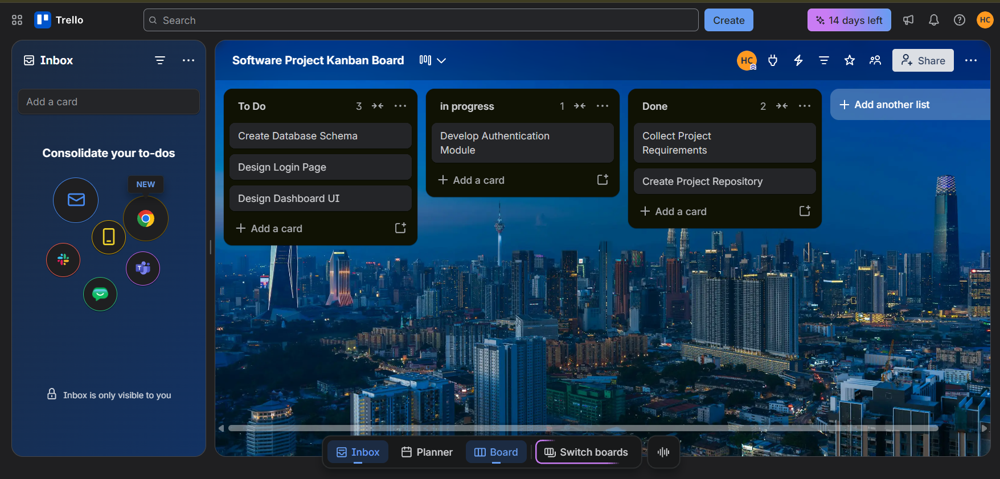

# Experiment 01: Kanban Board For Task Visualization Using Jira

**Tools Used:** Jira or Trello
**Course Outcome:** CO1

## Aim
To create a Kanban board in Jira with To Do, In Progress and Done columns, add at least five
sample tasks and move the tasks across the columns to simulate the workflow of a project.

## Software / Tools Required
Jira Software (Cloud) – free plan, or Trello

Web browser (Google Chrome / Microsoft Edge)

Atlassian account

## Theory
Kanban is a lean, visual method for managing work. Work items are written on cards and placed
on a board that is divided into columns, each column representing one stage of the workflow.
Team members pull a card into the next column only when they have capacity, so the board
always shows the real status of the project.

Visualize the workflow – every task is visible as a card on the board.

Limit Work In Progress (WIP) – only a fixed number of cards may sit in the In Progress
column, which prevents overloading.

Manage flow – cards move continuously from left to right; bottlenecks are seen immediately.

Continuous improvement – cycle time and lead time are measured and the process is
refined.
Unlike Scrum, Kanban has no fixed-length sprints; work flows continuously. In Jira a Kanban
project provides a board, a backlog, workflow statuses (To Do, In Progress, In Review, Done)
and reports such as the Cumulative Flow Diagram.

## Procedure
Step 1: Login

Open a web browser and navigate to the Jira website.

Login - https://id.atlassian.com/login

Sign in to your Jira account using your registered email address and password.

Department of Computer Science and Engineering | Page 5

After successful authentication, access the Jira dashboard to begin the project creation
process.
Step 2: Create The Kanban Project

Click the Create Project option from the Jira dashboard.

Select the Kanban project template to create a workflow-based project.

Enter the project details, including the project name "Task Management Board", choose
Team-managed as the project type, keep the access as Open, and provide a project key.

Click Next to continue with the project setup.
Figure 1.1 – Create The Kanban Project
Step 3: Configure The Project Settings

Review the default Work Types, including Epic, Feature, Task, Story, and Bug.

Verify the default workflow statuses such as To Do, In Progress, In Review, and Done.

Review the available project views, including Summary, List, Board, Calendar, Timeline,
Pages, and Forms.

Keep the Start with sample work items option disabled and click Next to complete the
configuration.

Department of Computer Science and Engineering | Page 6
Figure 1.2 – Configure The Project Settings
Step 4: Add Tasks to Backlog

Open the Backlog tab in the Kanban project to create and manage project tasks.

Click the Create button to add new work items to the backlog.

Create the required tasks, namely Restaurant Listing, Add Food to Cart, User Registration,
Payment Integration, Design Login Page, Collect Project Requirements, and Design UI
Mockups.

Assign the appropriate status to each task based on the project workflow.

Verify that the created tasks are successfully displayed in the Backlog, with completed and
active tasks shown according to their current workflow status.
Figure 1.3 – Add Tasks to Backlog

Department of Computer Science and Engineering | Page 7
Step 5: Create Issues (tasks)

Open the newly created Kanban Board and navigate to the To Do column.

Create the required project tasks by adding the following issues: Restaurant Listing, User
Registration, Add Food to Cart, Design Login Page, and Payment Integration.

Verify that all five tasks are successfully created and displayed in the To Do column of the
Kanban board.
Figure 1.4 – Create Issues (tasks)
Step 6: Move Issues Across The Workflow

Simulate the project workflow by dragging the created tasks to different workflow stages.

Move User Registration from To Do to In Progress.

Move Design Login Page from To Do to In Review.

Move Payment Integration from To Do to Done.

Keep Restaurant Listing and Add Food to Cart in the To Do column to represent pending
tasks.

Department of Computer Science and Engineering | Page 8
Figure 1.5 – Move Issues Across The Workflow
Step 7: Final Workflow Simulation

Complete the workflow simulation by moving Design Login Page from In Review to Done.

Keep User Registration in the In Progress column to indicate that the task is currently under
development.

Leave Restaurant Listing and Add Food to Cart in the To Do column to represent tasks that
have not yet been started.

Ensure that Payment Integration remains in the Done column, indicating that the task has
been successfully completed.

Verify that the Kanban board clearly displays the movement of tasks across the To Do, In
Progress, and Done stages, demonstrating the complete workflow of the project.

## Expected Output
A Jira Kanban project named “Task Management Board” is created.

Five or more tasks (Restaurant Listing, User Registration, Add Food to Cart, Design Login
Page, Payment Integration) are created in the To Do column.

Tasks are dragged across To Do →In Progress →In Review →Done, and the final board
shows tasks in every stage.

## Result
Thus the Kanban board was created in Jira, sample tasks were added and moved across the To
Do, In Progress and Done columns, and the project workflow was simulated successfully.

## Viva Voce Questions
1. What is Kanban?
Ans: A visual workflow-management method that uses a board, columns and cards to show
the status of work and to limit work in progress.

Department of Computer Science and Engineering | Page 9
2. What is a WIP limit?
Ans: The maximum number of work items allowed in a column at one time; it prevents
multitasking and exposes bottlenecks.
3. How does Kanban differ from Scrum?
Ans: Kanban has continuous flow without sprints or fixed roles; Scrum uses time-boxed
sprints, sprint planning and defined roles.
4. What is lead time and cycle time?
Ans: Lead time is from request to delivery; cycle time is from start of work to completion.
5. Name two reports available on a Jira Kanban board.
Ans: Cumulative Flow Diagram and Control Chart.

Department of Computer Science and Engineering | Page 10

## Screenshot

## Status
Completed and submitted to GitHub.
