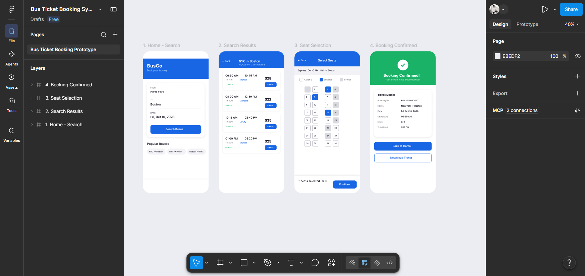

# Experiment 02: Prototype Of A Bus Ticket Booking System Using Figma

**Tools Used:** Figma
**Course Outcome:** CO1

## Aim
To sketch and build a simple clickable prototype of a Bus Ticket Booking System (Login screen
and Home/Search screen) using the Figma tool.

## Software / Tools Required
Figma (browser or desktop app) – free account

Web browser

## Theory
A prototype is an early, simplified model of a software product that is built to collect user
feedback before the real system is developed. Prototyping reduces the risk of building the wrong
product because stakeholders can see and click through the screens.

Low-fidelity prototype – rough sketches or wireframes showing only layout.

High-fidelity prototype – screens that look close to the final product, with colours, images
and interactions.

Throw-away vs evolutionary prototyping – a throw-away prototype is discarded after
feedback; an evolutionary prototype is refined into the final system.
Figma is a collaborative, web-based interface design tool. Designs are made inside Frames
(device-sized artboards). In Prototype mode, frames are connected with interactions (On Click
→Navigate to) and the flow can be previewed with the Present button.

## Procedure
Step 1: Login to Figma

Open a web browser and navigate to https://www.figma.com.

Sign in using your Figma account credentials.

After successful login, click New Design File.

Department of Computer Science and Engineering | Page 11
Figure 2.1 – Login to Figma
Step 2: Create a New Design

Click New Design File

A blank canvas will open
Step 3: Create a Frame

Select the Frame Tool(F)

Choose Desktop (eg,. Desktop (1440 x 1024)

A desktop frame will appear on the canvas
Step 4: Design the Login Screen

Add a title:Bus Ticket Booking

Insert text fields for:

Username

Password

Add Login button
Step 5: Create the Home Screen

Duplicate the frame

Add:

From

To

Travel Date

Search Buses button
Step 6: Connect the Screens

Switch to Prototype mode

Department of Computer Science and Engineering | Page 12

Connect:

Login →Home Screen
Step 7: Preview the Prototype

Click the Present (▶) button

Test the Complete booking flow
Figure 2.2 – Preview the Prototype
Figure 2.3 – Preview the Prototype

## Expected Output
A desktop frame with the Login screen (title “Bus Ticket Booking”, Username, Password
and Login button).

A Home screen with From, To, Travel Date fields and a Search Buses button.

Department of Computer Science and Engineering | Page 13

Login button linked to the Home screen in Prototype mode; the flow runs in Present mode.

## Result
Thus a simple clickable prototype of the Bus Ticket Booking System was designed in Figma and
the navigation flow was tested successfully.

## Viva Voce Questions
1. What is a prototype?
Ans: An early working model of a system used to understand and validate requirements.
2. What is a Frame in Figma?
Ans: A container (artboard) of a fixed size, such as a mobile or desktop screen, in which UI
elements are placed.
3. How are two screens linked in Figma?
Ans: In Prototype mode, drag the connection handle from an element to the target frame and
choose an interaction such as On Click →Navigate To.
4. Which SDLC model uses prototyping?
Ans: The Prototyping model, and also evolutionary/incremental models.
5. What is the difference between wireframe and mock-up?
Ans: A wireframe is a low-fidelity layout; a mock-up is a high-fidelity static visual design.

Department of Computer Science and Engineering | Page 14

## Screenshot

## Status
Completed and submitted to GitHub.
