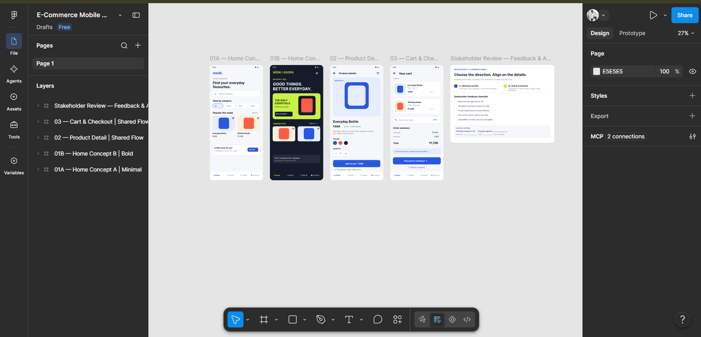

# Experiment 03: E-Commerce Mobile App Prototype Using Figma For Stakeholder Feedback

**Tools Used:** Figma
**Course Outcome:** CO1

## Aim
To design an interactive prototype of an E-Commerce mobile application using Figma so that
stakeholders with conflicting views on the user interface can review it and give feedback.

## Software / Tools Required
Figma – free account

Web browser

Figma Mirror / mobile preview (optional)

## Theory
When stakeholders disagree about the user interface, a prototype provides a common, concrete
artefact to discuss. Instead of arguing about descriptions, everyone reviews the same screens and
records comments directly on them.
A typical e-commerce app flow is: Home (categories, featured products) →Product Listing →
Product Details →Cart →Checkout. Designing each of these as a mobile frame (for example
iPhone 14, 390 × 844) and linking them gives a realistic click-through experience.

Components – reusable elements such as buttons, product cards and navigation bars.

Auto Layout – keeps spacing consistent when content changes.

Comments and Share – stakeholders can be invited with a link and add comments on any
part of the design.

Iteration – feedback is incorporated and a new version is presented, following the
prototyping life cycle.

## Procedure
Step 1: Login to Figma

Open a web browser and navigate to https://www.figma.com.

Sign in using your Figma account credentials.

Click New Design File to create a new project.
Step 2: Create a Mobile Frame

Select the Frame Tool (F).

Department of Computer Science and Engineering | Page 15

Choose a mobile device frame (e.g., iPhone 14 Plus).

Create separate frames for each screen of the application.
Step 3: Design the Home Screen

Add the application logo and title.

Include a search bar and product categories.

Display featured products with images, prices, and ratings.

Add a bottom navigation bar.
Figure 3.1 – Design the Home Screen
Step 4: Design the Product Details Screen

Create a new frame.

Display the product image, name, description, price, and customer ratings.

Add Add to Cart and Buy Now buttons.
Figure 3.2 – Design the Product Details Screen

Department of Computer Science and Engineering | Page 16
Figure 3.3 – Design the Product Details Screen
Step 5: Design the Shopping Cart Screen

Create another frame.

Display the selected products with quantity and price.

Show the total amount.

Add a Proceed to Checkout button.
Figure 3.4 – Design the Shopping Cart Screen
Step 6: Design the Checkout Screen

Create a new frame.

Add fields for delivery address, payment method, and order summary.

Include a Place Order button.

Department of Computer Science and Engineering | Page 17
Figure 3.5 – Design the Checkout Screen
Step 7: Design the Order Confirmation Screen

Create the final frame.

Display a confirmation message with the order ID.

Show the estimated delivery date.

Add a Continue Shopping button.
Figure 3.6 – Design the Order Confirmation Screen
Step 8: Create the Prototype

Switch to the Prototype tab.

Connect all screens using interaction arrows.

Set the navigation flow from the Home Screen to the Order Confirmation Screen.
Step 9: Review the Prototype with Stakeholders

Present the prototype using Present mode.

Review the user interface with stakeholders.

Collect feedback and note suggested improvements for the design.

Department of Computer Science and Engineering | Page 18
Step 10: Update and Save the Prototype

Modify the prototype based on stakeholder feedback.

Save the updated Figma design.

Capture screenshots of the final prototype for documentation and approval.

## Expected Output
Mobile frames for Home, Product Listing, Product Details, Cart and Checkout screens.

Screens connected in Prototype mode; the flow runs in Present mode.

The prototype link is shared with stakeholders and their feedback is recorded as comments.

## Result
Thus an interactive prototype of the E-Commerce mobile application was created in Figma and
shared with stakeholders to collect feedback on the user interface.

## Viva Voce Questions
1. Why is prototyping useful when stakeholders disagree?
Ans: It gives a visual, testable model so decisions are based on what users actually see rather
than on assumptions.
2. What is Auto Layout in Figma?
Ans: A feature that arranges child elements with automatic spacing and resizing, like CSS
flexbox.
3. What is a component in Figma?
Ans: A reusable design element; changes to the main component update all its instances.
4. How do you share a Figma prototype?
Ans: Click Share, set link access (can view / can comment) and send the prototype link.
5. Name two usability principles you applied.
Ans: Consistency of layout and visible navigation (clear call-to-action buttons).

Department of Computer Science and Engineering | Page 19

## Screenshot

## Status
Completed and submitted to GitHub.
